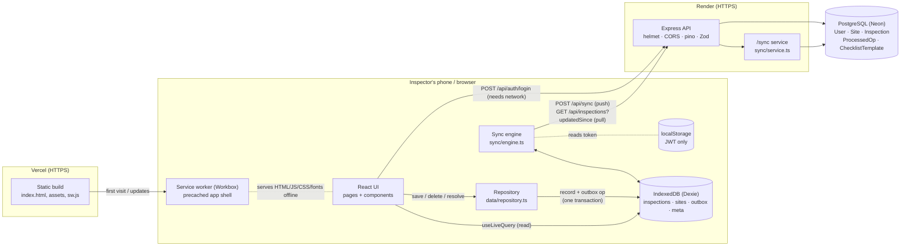
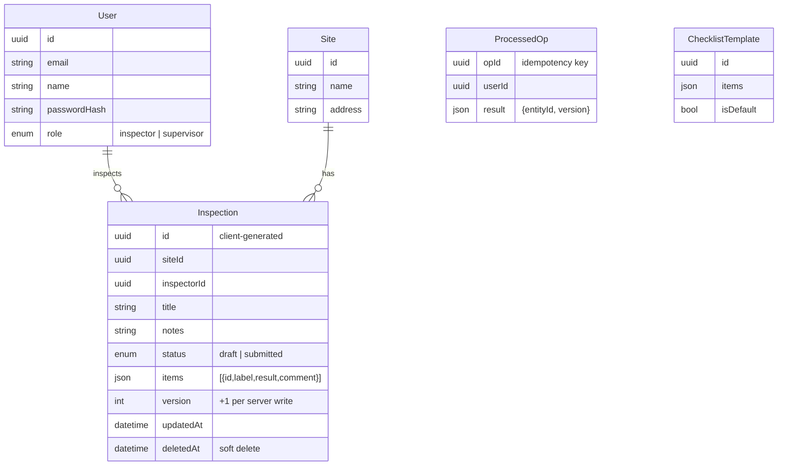
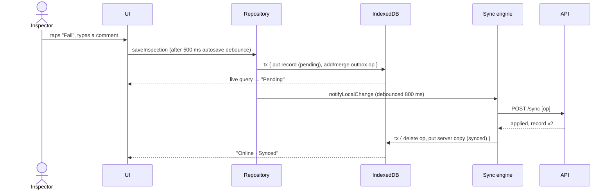
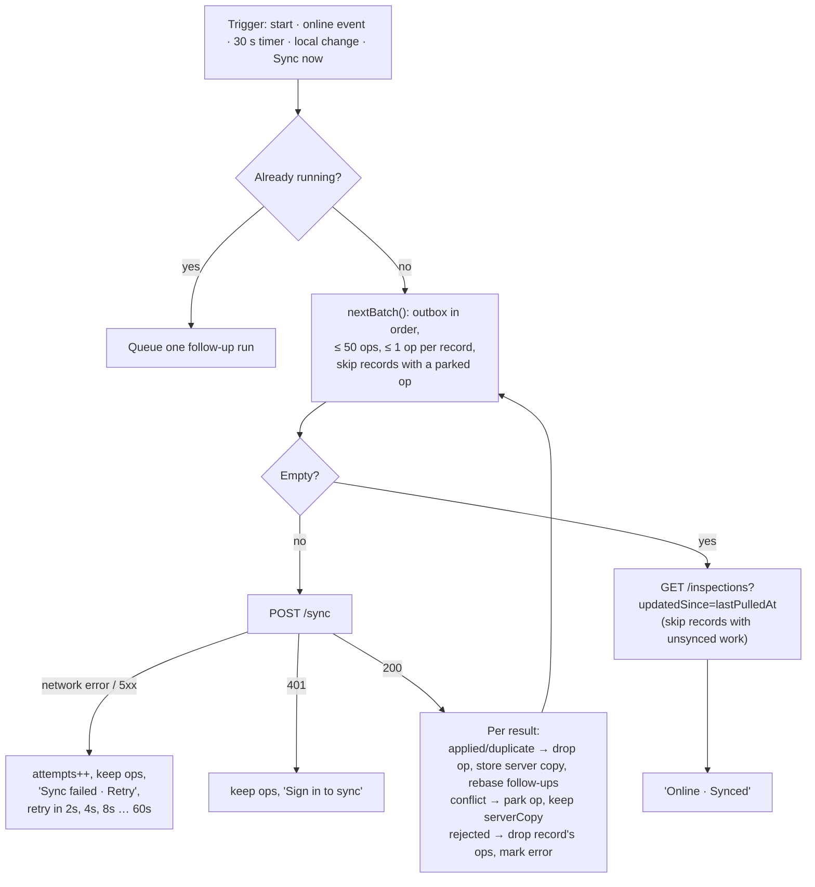

# Architecture

Siteward is an offline-first PWA (React) talking to a small JSON API (Express + Prisma + PostgreSQL).
The one rule that shapes everything: **the UI only reads and writes IndexedDB; the sync engine is
the only thing that talks to the server about data.**

## System

## Components

| Component | Where | Responsibility |
|---|---|---|
| Pages & components | `frontend/src/pages`, `frontend/src/components` | Render from IndexedDB via `useLiveQuery`; never call data endpoints. |
| Repository | `frontend/src/data/repository.ts` | The only writer: each change updates the record **and** appends/coalesces an outbox op in one Dexie transaction; conflict resolution (keep mine / keep server). |
| Validation | `frontend/src/data/validation.ts`, `backend/src/lib/validation.ts` | Same Zod rules and messages on both sides (ADR-008). |
| Sync engine | `frontend/src/sync/engine.ts` | Push outbox → handle per-op results → pull changes. Lock, triggers, backoff, 401 handling, debug replay. |
| Status | `frontend/src/sync/status.ts`, `components/SyncIndicator.tsx` | Engine state + live counts → header label (`Online · Synced`, `Offline · 3 pending`, …). |
| Auth | `frontend/src/auth/AuthProvider.tsx` | Login (online), cached user for offline boot, re-auth after expiry without losing data, sign-out clears the device. |
| Service worker | `frontend/vite.config.ts` (vite-plugin-pwa) | Precache app shell, SPA fallback, update prompt. No API caching. |
| API app | `backend/src/app.ts` | Security headers, CORS allow-list, JSON limit, logging, auth middleware, routes, error shape. |
| Sync service | `backend/src/sync/service.ts` | §6 server rules: idempotency via `ProcessedOp`, permission + validation, compare-and-set on `version`. |
| Read routes | `backend/src/routes/*.ts` | `auth`, `sites`, `checklist-template`, `inspections` (incremental pull), `health`, `docs`, demo tools. |

## Data model

## Data flows

### Online write

### Offline write

Identical up to the outbox. `syncNow` sees `navigator.onLine === false` and returns; the header shows
`Offline · N pending`. Records and ops are in IndexedDB, so they survive reloads and restarts; the
service worker serves the app shell. On the `online` event the engine syncs immediately.

### Sync (push, then pull)

### Conflict

A supervisor edits inspection v1 → v2 while the inspector, offline, edits based on v1. On reconnect
the inspector's op carries `baseVersion: 1`; the server's compare-and-set fails and it answers
`conflict` with `serverCopy` v2. Nothing is overwritten. The record turns red (`1 conflict`); the
conflict screen shows both versions side by side. **Keep mine** deletes the parked op and enqueues a
new op with `baseVersion: 2` (→ v3). **Keep server** deletes the op and stores v2 locally. Details:
[sync-protocol.md](sync-protocol.md).

## Security notes

- Passwords: bcrypt (cost 10). Login is rate-limited and does not reveal whether an email exists.
- JWT (HS256, 7 days) in `Authorization` headers; the user is reloaded from the DB on every request.
- Access control is enforced on the server for every read and write (inspectors: own records only).
- Helmet headers (HSTS, CSP for API/Swagger, nosniff, frame-ancestors), CORS allow-list, 2 MB body
  limit, Zod validation of every input, one error shape without stack traces.
- Signing out clears IndexedDB; a different user signing in on the same device clears the previous
  user's data (with an explicit warning when unsynced changes would be lost).
