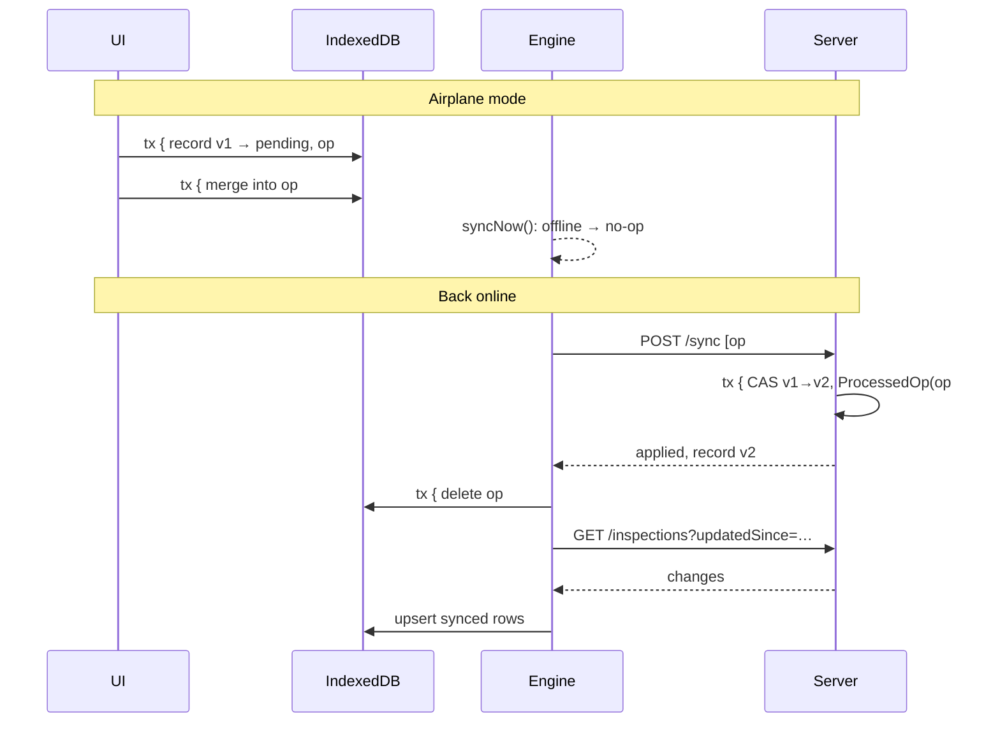
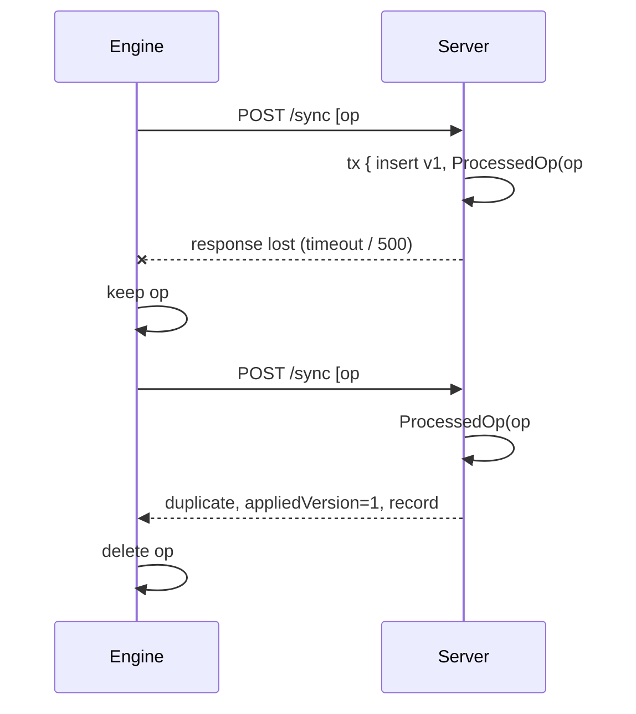
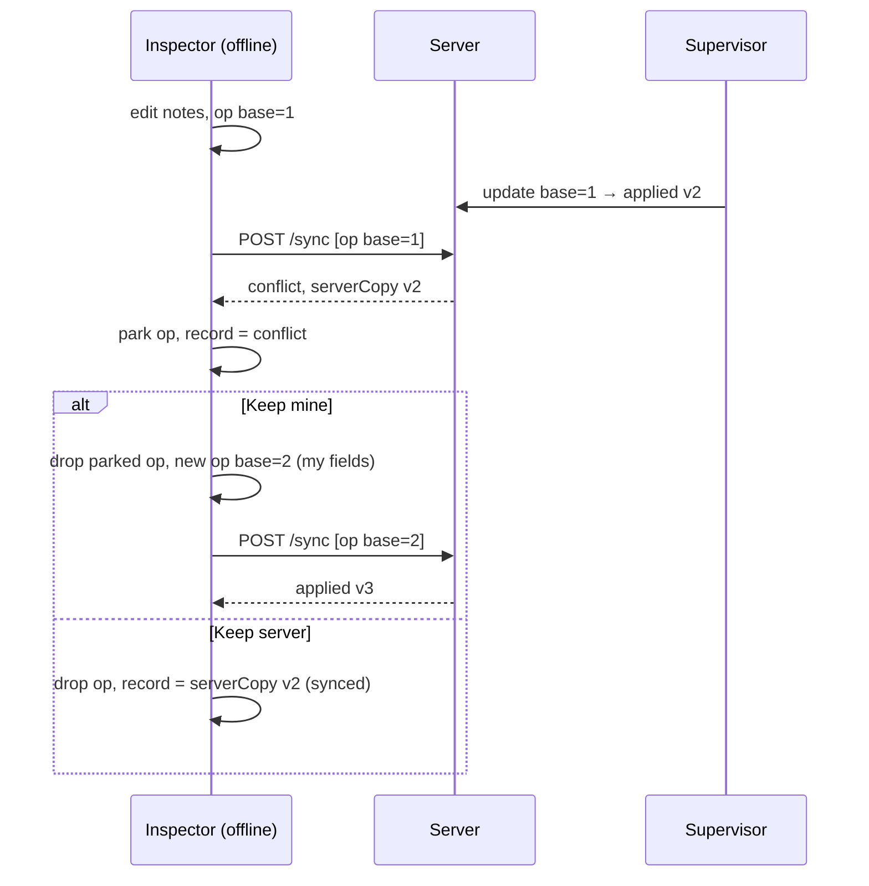
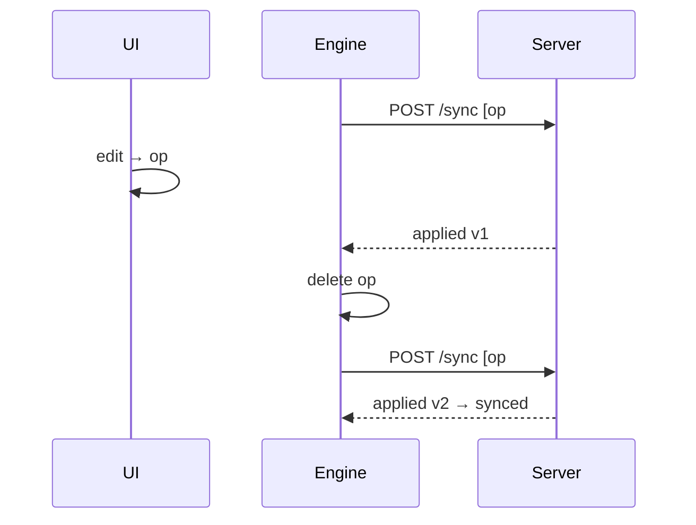

# Sync protocol

How Siteward keeps an offline client and the server consistent. Implements PLAN.md §6.
Server: [`backend/src/sync/service.ts`](../backend/src/sync/service.ts). Client:
[`frontend/src/sync/engine.ts`](../frontend/src/sync/engine.ts),
[`frontend/src/data/repository.ts`](../frontend/src/data/repository.ts). Formal schema:
[`openapi.yaml`](openapi.yaml) (`POST /sync`).

## 1. Client storage

| Store | Content | Notes |
|---|---|---|
| Cache Storage (service worker) | App shell: HTML, JS, CSS, Inter font, icons | Precached at install; app opens offline. |
| IndexedDB `inspections` | Local copy + `syncState` (`synced`/`pending`/`conflict`/`error`), `version` (last known server version, 0 = never synced), `serverCopy`, `syncError` | The UI's only data source. |
| IndexedDB `sites`, `meta` | Sites, checklist template, cached user, `lastPulledAt`, last sync info | Lets the app boot and create inspections offline. |
| IndexedDB `outbox` | Pending operations, ordered by an auto-increment `seq` | Replayed on reconnect. |
| localStorage | JWT | See ADR-015 for the tradeoff. |

## 2. Operations

```ts
{
  opId: uuid,                 // idempotency key, generated on the device
  type: 'create' | 'update' | 'delete',
  entity: 'inspection',
  entityId: uuid,             // inspection id, generated on the device (crypto.randomUUID)
  baseVersion: number | null, // server version this change is based on (null for create)
  payload: {...},             // create: siteId + fields; update: full fields; delete: {}
  createdAt, attempts, lastError,
  sentAt: string | null,      // first send time — a sent op is frozen
  parked: boolean,            // true after a conflict, until the user resolves it
}
```

**Writing (repository).** Every change writes the record (with `syncState: 'pending'`) and the op in
**one Dexie transaction**. Coalescing: if the newest op for that record has never been sent, the new
change is merged into it (an edit after a create stays a create with the latest fields; a delete turns
it into a delete). If it has been sent, it may already be applied on the server, so it is never
modified; a new op is appended. Deleting a record that never reached the server just removes it and
its ops locally.

## 3. Push

1. `nextBatch()` takes outbox ops in `seq` order, at most 50, **at most one per record**, and skips
   records that have a parked op.
2. Marks them `sentAt`, stores the batch body (for the debug panel's replay), `POST /api/sync`.
3. Per-op result:

| Result | Client action |
|---|---|
| `applied` (`record`) | Delete op. If more ops for this record are queued: set their `baseVersion = record.version` (rebase) and update the local `version`; else store `record` as the local copy, `synced`. |
| `duplicate` (`appliedVersion`, `record`) | Same as applied, rebasing on `appliedVersion` (the version *that op* produced, which may be older than the current record). |
| `conflict` (`serverCopy`) | Park the op; record `syncState: 'conflict'`, store `serverCopy`. Header: `1 conflict`. |
| `rejected` (`error`, `serverCopy?`) | Delete all ops for the record; `syncState: 'error'` with the message. The user fixes and edits again (new op) or **Discards** (restore `serverCopy`, or remove if it never existed on the server). |

4. Repeat until no eligible ops remain (follow-up ops become eligible after their rebase).

**Failures.** Network error or 5xx: ops stay, `attempts++`, `lastError` set, header
`Sync failed · Retry`, automatic retry after 2 s, 4 s, 8 s, … capped at 60 s; a manual retry,
reconnect or re-login skips the wait. 401: ops stay, header `Sign in to sync`; signing in again as the
same user keeps all local data and syncs.

**Triggers.** App start, `online` event, every 30 s while online (respecting backoff), 800 ms after a
local change, and the Sync now button. One run at a time; a trigger during a run schedules exactly one
follow-up run.

## 4. Server rules (`POST /api/sync`)

Envelope validated with Zod (≤ 50 ops, UUIDs, known types); an invalid envelope is a 400 for the whole
request. Then each op, in order, **in its own transaction**:

1. `ProcessedOp(opId)` exists → `duplicate` (with `appliedVersion` and the current record). Another
   user's `opId` → `rejected FORBIDDEN`.
2. **create**: validate payload → `rejected VALIDATION_ERROR` (with field `details`). Id already
   exists → `duplicate` if visible to the caller, else `rejected FORBIDDEN`. Unknown site →
   `rejected`. Insert with `version = 1`, `inspectorId = caller`.
3. **update / delete**: load; missing → `rejected NOT_FOUND`; not the caller's (inspector) →
   `rejected FORBIDDEN`; validate → `rejected VALIDATION_ERROR`; `baseVersion ≠ version` →
   `conflict` + `serverCopy`; inspector on a submitted inspection → `rejected LOCKED`.
   Apply with compare-and-set `UPDATE … WHERE id = ? AND version = baseVersion`, `version + 1`
   (0 rows → `conflict`). Delete is soft (`deletedAt`).
4. If applied: insert `ProcessedOp { opId, userId, result: { entityId, version } }` **in the same
   transaction**. Conflicts and rejections write nothing and are not recorded, so retrying them
   re-evaluates against current data.
5. Two identical requests racing: the loser hits the `ProcessedOp` primary key, its transaction rolls
   back, and it is re-run → `duplicate`. Exactly one write.

## 5. Pull

`GET /api/inspections?updatedSince=<lastPulledAt>` returns visible rows with `updatedAt ≥ updatedSince`,
**including soft-deleted ones**, plus `serverTime`. The client:

- skips any record with queued ops or a non-`synced` state (never overwrites local work); for
  `conflict`/`error` records it refreshes `serverCopy` if the server has a newer version;
- deletes local rows whose server copy is deleted; upserts the rest as `synced`;
- on a full pull (no `lastPulledAt`) removes local synced rows the server no longer returns;
- stores `lastPulledAt = serverTime − 2 s` (overlap so rows committed during the request are not
  missed; re-applying a row is harmless).

## 6. Sequence diagrams

### Offline edit, reconnect, sync



### Lost response → retry → duplicate (AC6)



### Conflict and resolution (AC7)



### Edit while an op is in flight (rebase)



## 7. Limits of offline behaviour

- The **first visit must be online** (to install the service worker and download sites + template).
- **Signing in needs the network.** Once signed in, the app opens offline.
- If the **token expires while offline**, edits keep working locally; syncing needs a new sign-in
  (data is kept).
- Storage is bounded by the **browser quota**; very old devices or private browsing may evict data.
- **Clearing site data** (or signing out) deletes unsynced changes. Sign-out warns first.
- **No real-time push**: other users' changes arrive on the next pull (≤ 30 s while online, or Sync now).
- Conflicts are resolved per **whole record** (no field-level merge).
